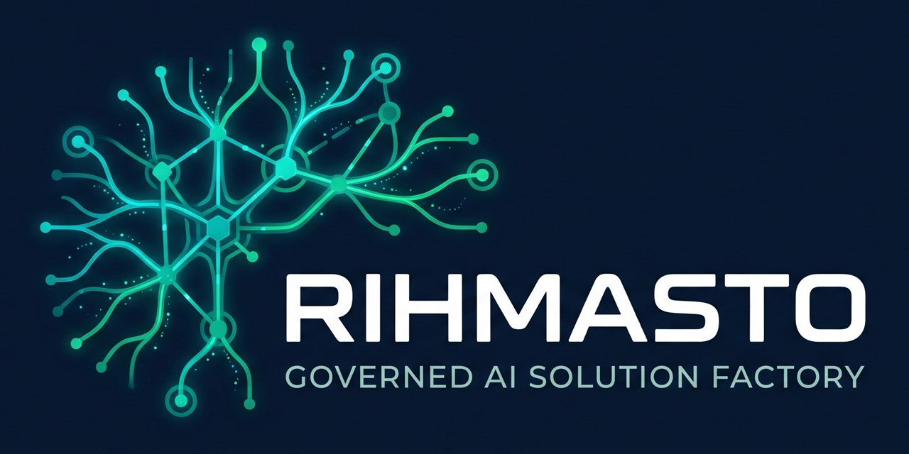

<p align="center">
  
</p>

# Rihmasto

Rihmasto is a governed middle layer for agentic software work. It takes an idea or an existing
repository, turns it into a spec and a tested contract, has coding agents build against it behind a
gate that runs the tests itself, ships only to targets you configured, and keeps it healthy, with a
person signing every decision and every step in a hash-chained ledger.

You keep your own IDE and coding agents (Claude Code, Cursor, Codex, OpenCode). Rihmasto holds what
they should not have to: the intent, the contract, the decisions, the verification and the record.
[Gnomon](https://github.com/eljaplacido/gnomonharness), an open agent harness, is the glue: any
harness and any model work under one structure of specs, contracts, tests and verification.

> Models propose. The kernel (plain code, with no model in it) decides. People own intent and policy.

**Status: alpha (1.0.0a1), one maintainer, Apache-2.0.** The chain runs end to end and is covered
by an offline test suite with scripted models. The one delivery target that has run for real is the
local preview on your own machine; the docker and Google Cloud Run roads, proxy sign-in, notices and
data connectors are tested only against stand-ins. The live acceptance run with real models has not
happened yet. [Status](#status) has the whole list.

## Contents

- [What it is, and what it is not](#what-it-is-and-what-it-is-not)
- [Capabilities](#capabilities)
- [Get started](#get-started)
- [Architecture](#architecture): the picture, and how the parts relate
- [Tech stack](#tech-stack)
- [Data layer](#data-layer) and [knowledge layer](#knowledge-layer)
- [Agentic capabilities](#agentic-capabilities) and [the Gnomon harness](#the-gnomon-harness-and-the-kernel)
- [Use scenarios](#use-scenarios): blank page, existing project, how much structure to enforce,
  improving, fixing an ungoverned project, workflows and automations
- [Status](#status), [documentation](#documentation), [contributing](#contributing-security-and-licence)
  and [version history](#version-history)

## What it is, and what it is not

**It is** the platform around your IDE for a capability's whole life
([D-0023](decisions/D-0023-what-rihmasto-is-and-is-not.md)): it takes in what development produced,
holds the intent, the contract and the decisions, verifies and packages the result, sends it to the
targets IT configured with people deciding, watches it, and brings feedback back to development. It
never strands you: every refusal says why and what to do, and every empty view offers **Ask Rihma**
why it is empty and how to fill it.

**Solo by default.** On a new home you are the one person and hold every persona; only what blocks
work waits for you. Team mode, an identity provider and IT's access file come later, when you need
them ([access](docs/guides/access.md)).

**It is not:**

- **an IDE or a code editor.** Write code where you like. Rihmasto reads that work's specs, tests and
  conventions, aligns them with its contract through proposals a person accepts, and hands context back;
- **a replacement for your CI, monitoring or ticketing.** It reads CI status, runs its own gate and
  checks, and exports to your observability tools. It is the system of record for decisions and
  evidence, not for telemetry or tickets;
- **tied to one harness or one model.** Gnomon is the default; other harnesses run cells opt-in, with
  the rules checked after the run ([D-0019](decisions/D-0019-other-harnesses-as-opt-in-cell-runners.md));
- **an autopilot without people.** Autonomy is capped, delegated, sandboxed and recorded. No
  automation makes a decision that waits for a person;
- **a place where a step can skip the record.** A light posture asks less and gates less. It never
  drops provenance ([D-0017](decisions/D-0017-governance-everywhere.md)).

## Capabilities

Each capability works in the cockpit and through Ask Rihma, and most from the command line too.
*(stand-ins)* means tested only against fakes, never a real system; *(preview)* means partly built.

| Area | What you can do | Guides |
|---|---|---|
| **Intake and shaping** | Shape a need in chat or from a spec, plan or folder; a panel asks only the questions that change what gets built; 13 kinds of work (3 ready, 10 *preview*) and four postures; change any of it later. | [shape it in chat](docs/guides/shape-in-chat.md), [inputs](docs/guides/inputs.md), [postures](docs/guides/postures.md), [change anything](docs/guides/change-anything.md) |
| **Existing projects** | Adopt or attach a repository, capture its own structure (specs, ADRs, API contracts, tests, AI-tool setup), assess it with live progress, align its specs and tests with a contract, watch upstream drift. | [existing project](docs/scenarios/existing-project.md), [alignment](docs/guides/alignment.md), [assessment](docs/guides/assessment.md) |
| **Build and verify** | A contract pinned by its hash; builder cells in Gnomon; a gate that runs the tests itself, checks fail-first, asks a verifier from another model family and runs holdouts the builder never saw; a security gate. | [how it works](docs/how-it-works.md), [harnesses](docs/guides/harnesses.md), [security](docs/guides/security.md) |
| **Run and deliver** | The local preview road (real); docker and Google Cloud Run *(stand-ins)*; Azure Container Apps *(preview)*; outputs per audience; small capabilities over MCP, an OpenAI-compatible endpoint, a website chat or HTTP. | [deploying](docs/guides/deploying.md), [destinations](docs/guides/destinations.md), [small capabilities](docs/guides/small-capabilities.md) |
| **Keep it healthy** | Scheduled checks, probes that open incidents, automations with guards and a circuit breaker, self-healing with remedies and Investigate with Rihma, a recorded console, Review each morning. | [improve and maintain](docs/scenarios/improve-and-maintain.md), [automations](docs/guides/automations.md), [self-healing](docs/guides/self-healing.md) |
| **Agents** | Ask Rihma in every view; walkthroughs; goals; hand-offs to your coding agent; the agent channel; an MCP server for your IDE agent; your coding agent as Rihmasto's model. | [configure with your agents](docs/guides/configure-your-agents.md), [agentic help](docs/guides/agentic-help.md), [MCP](docs/mcp.md) |
| **See and govern** | Insights, the Knowledge graph view, the Context and data view, Gnomon's audits and evals, capability and evidence packs, solo or team access, the autonomy cap. | [insights](docs/guides/insights.md), [knowledge graph](docs/guides/knowledge-graph.md), [packs](docs/guides/packs-and-evidence.md), [access](docs/guides/access.md) |
| **Integrations** | Website chats, signed events out and verified webhooks in; Teams, Slack and email notices, data bindings and a Google Drive connector *(stand-ins)*. | [embeds](docs/guides/embeds.md), [events](docs/guides/integrations.md), [data](docs/guides/data-integrations.md) |

Use as little as you need: spec only, gate my code, assess, security or evidence only, a capability,
or the whole chain ([modules and presets](docs/guides/use-only-what-you-need.md)).

## Get started

You need Python 3.11 or later and git. The demo needs no Gnomon, no model keys and no network.

```bash
git clone https://github.com/eljaplacido/rihmastoai rihmasto && cd rihmasto
python -m venv .venv && . .venv/bin/activate      # Windows: .venv\Scripts\activate
pip install -e .
rihmasto demo && rihmasto-cockpit --home var/demo
```

Open the one-use sign-in link it prints, on 127.0.0.1. The demo home is the real kernel with a
scripted model and builder standing in for Gnomon ([what it holds](docs/demo.md)).

Then, for real work:

1. **Check the machine:** `rihmasto doctor` (Rihmasto's own version, Python, Gnomon, git, docker, model keys;
   never a key's value). `rihmasto --version` prints the version alone; **Settings > About and help** shows both.
2. **Install Gnomon** with its installer, and verify its checksums and provenance
   ([how](docs/getting-started.md#verify-what-you-install)).
3. **Pick a model**, local or hosted, in **Settings > Models setup** or with `rihmasto models set`;
   or let the coding agent you already have answer, with `rihmasto models use claude-code`
   ([models setup](docs/guides/models-setup.md)). The verifier is always another model family than the
   builder.
4. **Start the cockpit on your own home:** `rihmasto-cockpit` with no `--home` (it uses
   `$RIHMASTO_HOME`, else `var/` in the checkout). Name yourself once; in solo mode you decide in every
   persona.
5. **Connect your coding agent** over MCP ([configure with your agents](docs/guides/configure-your-agents.md)),
   then pick a [scenario](#use-scenarios).

Not sure where to begin? Ask Rihma "how do I get started?" and press **Walk me through it**.
[Getting started](docs/getting-started.md) has every step in detail.

## Architecture


[docs/architecture.md](docs/architecture.md) has the same picture as a Mermaid diagram, each layer
with the code behind it, and how a decision travels through them.

**How the parts relate, top to bottom:**

1. **Where people and agents meet it.** The cockpit (web UI), Ask Rihma (chat in every view), the
   `rihmasto` command line, the MCP server for your IDE agent, and doorbells (signed webhooks, website
   chats, signals). Every write is signed by a person and a persona; a doorbell never decides.
2. **The kernel** decides by rule and runs the chain: material and intake, spec, a contract compiled
   with no model and pinned by its hash, the plan with holdouts in custody, builder cells, the gate,
   delivery and operation, and the change loop back. People decide in the Inbox; access, autonomy,
   posture, checks and automations sit beside the chain.
3. **The data layer** is plain files in the factory home: a hash-chained ledger per project, the
   canon, spec and contract, the product's git repository, and the holdout custody outside every
   builder's reach.
4. **The knowledge layer** reads those records and writes nothing: the knowledge graph, context packs,
   Insights and Review, and the structure map of an existing repository.
5. **The agent layer.** Every model call goes through Gnomon, which runs the Rihma agents within their
   tools, write scope and sandbox, on local or hosted models.
6. **Destinations** are paved roads IT configured. Probes, incidents and feedback come back through
   the change loop.

```text
a need or an existing project: an idea, a spec, a folder, a signal, a repository
  |
  v
material map ..... each file read, summarised, listed or skipped, with why; secrets never read
intake panel ..... the questions that change what gets built; people answer or let Rihma assume
spec ............. given / when / then criteria; the kernel sets ids and who confirmed what
hashed contract .. compiled with no model; every criterion needs a test named by its id
builder cells .... each task in a Gnomon cell (or another harness, checked after), in its write scope
gate ............. tests run by the kernel, fail-first, an independent verifier, holdouts
delivery ......... paved roads only; IT's deploy gate; shadow, canary, rollback
keep healthy ..... checks, probes, incidents, automations, self-healing, the change loop
```

## Tech stack

| Part | Built with |
|---|---|
| Kernel, command line, MCP server, gateway, embeds | Python 3.11+ **standard library only**: no package dependencies at runtime or in the tests ([D-0002](decisions/D-0002-kernel-language-python.md)) |
| Cockpit | a standard-library HTTP server bound to 127.0.0.1, and plain JavaScript, HTML and CSS with no framework and no build step |
| Agent harness | [Gnomon](https://github.com/eljaplacido/gnomonharness) (Node 22+), reached only as a command; Rihmasto's one runtime dependency |
| Models | any OpenAI-compatible endpoint per role: local (llama.cpp, vLLM, any compatible server) or hosted; or Claude Code, Codex or OpenCode on your own login |
| Storage | files and git: JSON, JSONL ledgers, git repositories; no database |
| Interfaces | MCP over stdio (JSON-RPC 2.0); a JSON API behind the cockpit; Standard Webhooks and CloudEvents for events; SARIF in; CycloneDX SBOMs out; OpenTelemetry JSON export |
| Tests and CI | `unittest`, headless Chrome over the DevTools protocol for the cockpit, GitHub Actions on Ubuntu and Windows with Python 3.11 and 3.12 |

## Data layer

Everything Rihmasto knows is in the **factory home** (`--home`, else `$RIHMASTO_HOME`, else `var/` in
the checkout): plain files you can read, back up and move.

- **The ledger.** Each project has a `ledger.jsonl`: one JSON record a line, each carrying the hash of
  the one before it, appended under a lock. Every transition lands here, with who did it and as which
  persona. A chain check finds an edit to any part of it.
- **The canon.** Briefs, questions, answers, assumptions with due dates, decisions and Inbox cards.
- **Spec and contract.** `spec.json` and `contract.json`; the contract's revision is the hash of its
  content.
- **The product.** `repo.git`, with builder cells working in lanes (git work trees) of their own.
- **The holdout custody**, outside every project folder and lane, so no builder reads its own exam.
- **No secrets.** Keys stay in environment variables named in the routing; deploy packages carry
  references, never values.

The **Data and context** page shows every store and its size, verifies every ledger's chain, and
proposes clean-ups a person signs ([context and data](docs/guides/context-and-data.md)).

## Knowledge layer

Read models built from the records, never a second source of truth:

- **The knowledge graph** links requirements, criteria, tests, tasks, decisions, changes, releases and
  agent runs by a small ontology ([kernel/ontology.json](kernel/ontology.json)). It answers "what does
  this rest on?" and "what breaks if this changes?", and finds what is missing: a criterion with no
  test, a release resting on a refuted assumption ([the view](docs/guides/knowledge-graph.md),
  [the design](docs/knowledge-graph.md)).
- **Context packs**: what each agent is given right now, part by part, what was compressed or left out
  and why.
- **Insights and Review**: health, security, QA, governance and usage counted from the records, and
  "not measured" when nothing is behind a number.
- **The structure map** of an existing repository: its specs (spec-kit, Kiro, BMAD, Gherkin), ADRs,
  API contracts, tests, CI and AI-tool setup, found by rule and never run.

## Agentic capabilities

**Rihma agents** are Rihmasto's own, each a role in [kernel/routing.json](kernel/routing.json):

| Agent | Does | Never |
|---|---|---|
| Analyst | runs intake and writes the spec | decides what is accepted |
| Holdout author | writes the test scenarios the builder never sees | shows them to a builder |
| Builder | writes code for one task in a cell | writes outside the task's scope |
| Verifier | reviews the work read-only, always from another model family | judges its own family's work |
| Assistant (Ask Rihma) | answers in every view, by rule first; proposes actions | writes without your confirm |

**Your agents** work beside them: over MCP they read the contract and file proposals; a hand-off gives
them a brief; the agent channel keeps people, Rihma agents and coding agents in one recorded thread;
optionally they answer Rihma's text roles or run cells. **Delegation** lets an agent decide chosen
kinds of card in your name until a date you set, and some kinds are never delegated. **Agent
observability** (an optional module) shows what IDE agents did in a repository, from session metadata
only ([guide](docs/guides/agent-observability.md)).

*Rihmasto* is Finnish for a mycelium, the whole network of fungal threads. One thread is a *rihma*: a
single agent in Rihmasto is **a Rihma agent** ([D-0013](decisions/D-0013-name-rihmasto.md)).

## The Gnomon harness and the kernel

Two different things keep the work honest:

- **The Rihmasto kernel** is standard-library Python with no model in it. It decides by rule whether
  work is accepted, writes the ledger, and stops at each decision that is a person's.
- **Gnomon** is the agent harness that runs every model call. It enforces each agent's tools, write
  scope and sandbox during the run, clamps an untrusted surface until its owner trusts it, and keeps its
  own audit trail. The kernel reaches it only as a command (`gnomon task --role <role> --json` in a
  lane), so Rihmasto never calls a model API itself.

Two exceptions are recorded as such: when your coding agent answers the text roles, each call is in
Rihmasto's ledger as run by that agent, with no Gnomon audit trail; and when another harness runs a
cell, its rules are checked after the run, not enforced during it ([harnesses](docs/guides/harnesses.md)).
Gnomon's own audits and evals also run as checks on a project ([audits and evals](docs/guides/audits-and-evals.md)).

## Use scenarios

Each scenario guide walks through the cockpit, Ask Rihma and the command line, then says **what
happens under the hood**. The [scenario index](docs/scenarios/README.md) helps you pick.

| You start from | Guide | Under the hood, in one line |
|---|---|---|
| A blank page: an idea, a sentence, a folder of notes | [Start from a blank page](docs/scenarios/start-blank.md) | the analyst asks what matters, the kernel compiles a hashed contract, Gnomon builds each task in a cell, the gate judges it, the local preview runs it |
| A working repository (brownfield) | [Bring in an existing project](docs/scenarios/existing-project.md) | read by rule from a committed revision, a test baseline recorded as behaviour, its own specs proposed for a contract; your folder is never written |
| A choice: enforce Rihmasto's structure or not | [How much structure to take on](docs/scenarios/existing-project.md#how-much-structure-to-take-on) | five levels from watch only to the full chain; each is the same record, with less or more asked of you |
| A project that should get better and stay healthy | [Improve and maintain](docs/scenarios/improve-and-maintain.md) | one change loop for feedback, incidents, failed checks and drift; Review counted from the ledger |
| Agentic work without governance, reliability or traceability | [Fix a project that lacks governance](docs/scenarios/fix-ungoverned-project.md) | capture, measure, write down, put agents under the contract, gate, trace; nothing stops the work |
| Repeated work, or a job with no screens | [Build workflows and automations](docs/scenarios/workflows-and-automations.md) | a trigger, a guard and an allow-listed action run with the owner's rights; a workflow product is built through the same chain |

## Status

Version **1.0.0a1**, alpha, with one maintainer ([governance](GOVERNANCE.md)). There has been no
independent security review or penetration test; it is installed from source, with no release on a
package registry. It is not yet recommended for production company use. Commands, file formats and
the cockpit's API may still change before 1.0.0. [SECURITY.md](SECURITY.md) has the threat model.

**Built and covered by the offline test suite** (scripted models, no network): the chain from intake
to delivery on the local preview road; the command line, the demo, the cockpit and the MCP server;
Shape it in chat, walkthroughs, goals, hand-offs, the agent channel and Ask Rihma; adopting, attaching,
assessing and aligning existing repositories; checks, automations, probes, incidents and self-healing;
Review, Insights, the Knowledge graph and Context and data views; packs, the autonomy ladder,
delegation and the autopilot; solo and team access; Rihmasto's own static scan, dynamic probes and
agentic red team. The live end-to-end acceptance run with real models has not happened yet
([acceptance](docs/acceptance.md)).

**Built, tested only against stand-ins:** the docker road (a fake docker CLI); the Google Cloud Run
road and the Google Drive connector (a fake gcloud and a Drive stand-in); proxy sign-in (tokens signed
with test keys, never a real Entra ID, Okta, Google IAP or AWS load balancer); data bindings (local
fakes; `os:`, `cmd:` and vault references are not resolved); Teams, Slack and email notices and signed
events out (local receivers); your coding agent as the model and other harnesses as cell runners
(fake Claude Code, Codex and OpenCode commands); the agent sessions view (a stub of the observability
hub, which is not public).

**Preview:** ten of the thirteen kinds of work, which build on the web-service template; the Azure
Container Apps road, rendered and validated but never deployed; recipes, sandbox trials and offline
bundles, from Python only; the capability gateway (`python -m gateway.server`).

**Designed, not built:** integrations through Gnomon as governed tool calls; the portability exports;
publishing to a registry; signed and anchored ledger heads, signed packs and SBOMs; SCIM provisioning
and separation of duties; projects on other machines over SSH.

**Know before you rely on it:**

- **No paved road delivers an adopted repository yet.** Rihmasto adopts, aligns, gates its Python
  unittest suite, checks and watches it, but does not deploy it. Other suites are characterised and can
  run as checks; the gate does not run them.
- **What leaves the machine.** Project material goes to whichever endpoint each role routes to. Mark a
  project confidential to keep its calls on local or private endpoints. Your coding agent as the model
  uses that person's own account and its terms, which may not match your company's AI policy.
- **Secrets** are held by name in the host's environment, or in a key file outside the repository.
  There is no vault integration yet.
- **The ledger** shows an edit to part of its chain, but someone with file access who rewrites the
  whole chain consistently is not detected until ledger heads are signed and anchored. Rihmasto makes
  no compliance certification; a compliance mapping is a mapping, not an attestation.
- **One process on one machine.** The cockpit binds only to 127.0.0.1; a team reaches it through IT's
  HTTPS front or identity-aware proxy, or an SSH tunnel. No database and no high availability: back
  the home up yourself.
- **Without an access file, personas are self-declared** and the cockpit says so. When code a model
  wrote must not run as the operator, use IT's access file and its isolation runner.
- **Builder cells have run on Linux.** On Windows the kernel, the tests, the demo and the cockpit run;
  run cells in WSL2 or a container.
- **Cost** reads "not measured" until someone fills the per-token prices in
  [kernel/prices.json](kernel/prices.json). Put your own model routing in `kernel/routing.local.json`
  (gitignored), never in the shipped [kernel/routing.json](kernel/routing.json).
- File-format ids such as `gnomonfactory.contract/1` keep the project's working name, so existing
  files stay valid.

## Documentation

[docs/README.md](docs/README.md) lists every guide by capability area and by scenario. To start:

- [Getting started](docs/getting-started.md): install, the demo, Gnomon with checksum verification,
  local and hosted models, a first real project, the cockpit.
- [Configure with your agents](docs/guides/configure-your-agents.md): Claude Code, Cursor, Codex and
  OpenCode through MCP, your conventions file and hooks.
- [Architecture](docs/architecture.md) and [how it works](docs/how-it-works.md): the parts, and the
  chain step by step.
- [Scenarios](docs/scenarios/README.md): what to do, and what happens under the hood.
- [The cockpit](docs/cockpit.md): every view, the lenses and the API.
- [Decisions](decisions/): every decision, who made it and why.

## Contributing, security and licence

- **Contributing:** [CONTRIBUTING.md](CONTRIBUTING.md). Work is spec-first: a criterion, a test named
  after it that fails first, then the change. Sign off each commit (`git commit -s`) under the
  Developer Certificate of Origin. A contribution reaches `main` only through a pull request
  ([how `main` is protected, and how to check it](docs/maintainers.md#the-repositorys-settings)).
- **Questions:** [GitHub Discussions](https://github.com/eljaplacido/rihmastoai/discussions).
- **Conduct:** the [Contributor Covenant 2.1](CODE_OF_CONDUCT.md).
- **Governance:** maintainers and how decisions are made, in [GOVERNANCE.md](GOVERNANCE.md).
- **Security:** report a vulnerability privately, as [SECURITY.md](SECURITY.md) explains. Do not open a
  public issue for it.
- **Licence:** [Apache License 2.0](LICENSE). Copyright 2026 The Rihmasto authors; see [NOTICE](NOTICE).

## Version history

Versions follow [PEP 440](https://peps.python.org/pep-0440/) and every notable change is in
[CHANGELOG.md](CHANGELOG.md), newest first, one section per version. A version is published by pushing
its tag: the release workflow builds the source archives, a CycloneDX SBOM, `SHA256SUMS` and a signed
build provenance attestation, and a GitHub Release carries them
([maintainers](docs/maintainers.md)).
